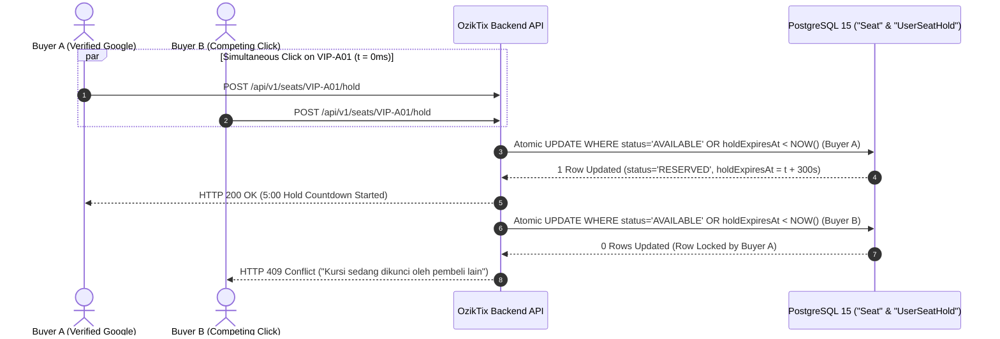
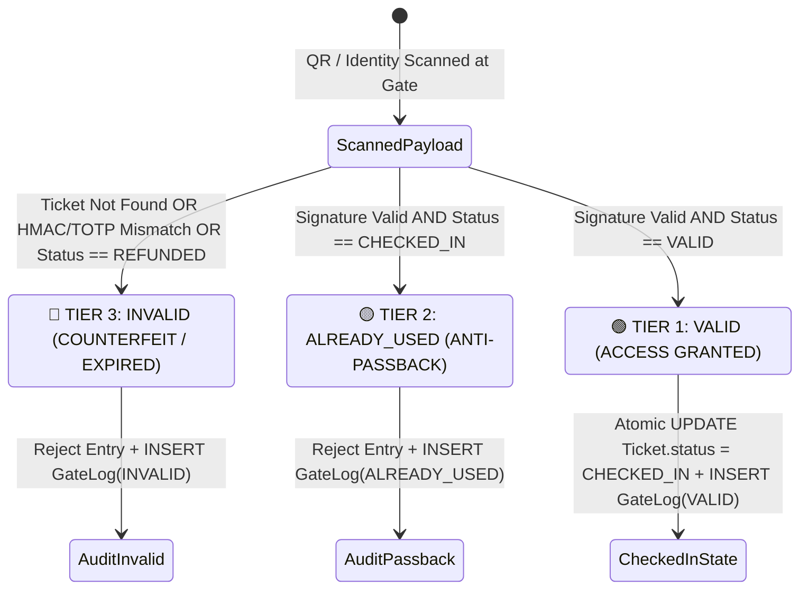
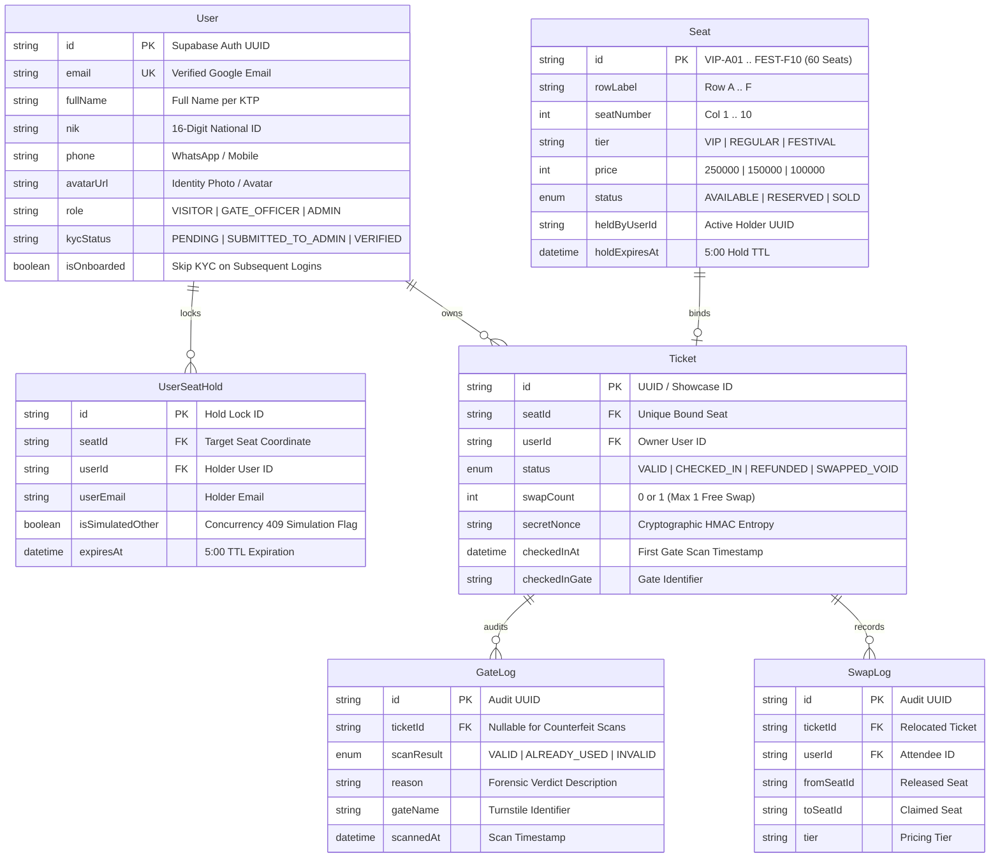

# OzikTix — High-Concurrency Seat Reservation & Cryptographic Anti-Passback Engine

[](https://oziktix.vercel.app)
[](https://oziktix.onrender.com/api/v1/health)
[](https://github.com/otaruram/oziktix)
[](https://supabase.com)
[](#4-cryptographic-digital-pass--dynamic-30s-totp-specification)

> **Summarecon Mall Bandung (SMB) Atrium Gala 2026 — Bandung Build Challenge 2026**  
> Engineered to eliminate ticket scalping, double-booking race conditions, static QR screenshot fraud, and gate passback attacks under flash-crowd load.

---

## Table of Contents

1. [Executive Summary & Problem Statement](#1-executive-summary--problem-statement)
2. [High-Level System Architecture](#2-high-level-system-architecture)
3. [Concurrency Control & Atomic Row-Level Locking Protocol](#3-concurrency-control--atomic-row-level-locking-protocol)
4. [Cryptographic Digital Pass & Dynamic 30s TOTP Specification](#4-cryptographic-digital-pass--dynamic-30s-totp-specification)
5. [Atomic Seat Relocation (1x Free Swap) & Entropy Rotation](#5-atomic-seat-relocation-1x-free-swap--entropy-rotation)
6. [3-Tier Gate Turnstile State Machine & Camera-Free Judge Simulator](#6-3-tier-gate-turnstile-state-machine--camera-free-judge-simulator)
7. [Relational Schema & Row-Level Security (RLS) Topology](#7-relational-schema--row-level-security-rls-topology)
8. [High-Availability, Connection Pooling & Zero-Cold-Start Engineering](#8-high-availability-connection-pooling--zero-cold-start-engineering)
9. [REST API Contract Specification](#9-rest-api-contract-specification)
10. [60-Second Judge Evaluation Checklist](#10-60-second-judge-evaluation-checklist)
11. [Local Development & Production Deployment](#11-local-development--production-deployment)

---

## 1. Executive Summary & Problem Statement

Conventional event ticketing systems fail under three adversarial conditions common to high-demand venue events:

| Failure Mode | Conventional Ticketing Slop | OzikTix Engineering Invariant |
| :--- | :--- | :--- |
| **Flash-Crowd Race Conditions** | Read-Modify-Write (`SELECT` then `UPDATE`) causes double-booked seats when 100+ users click the same coordinate simultaneously. | **Atomic Conditional Compare-And-Swap (CAS) SQL** with a strict **300-second (5:00) Hold TTL** and immediate `HTTP 409 Conflict` rejection. |
| **Bot & Scalper Hoarding** | Anonymous checkout or unverified accounts allow automated scripts to lock entire rows. | **2-Stage Identity Gate:** Mandatory Google OAuth 2.0 + 16-digit National ID (`NIK KTP`) KYC onboarding, enforcing a hard ceiling of **$\le 2$ seats per verified account** (`HTTP 429 Too Many Requests`). |
| **Static Screenshot Replay & Passback** | Static PDF/PNG QR codes are screenshotted and shared across multiple buyers or resold outside the venue. | **Stateful HMAC-SHA256 + 30-Second Rotating TOTP Nonce** bound to `(ticketId, seatId, userId, timeWindow, secretNonce)` with a **3-Tier Anti-Passback Gate Turnstile**. |

---

## 2. High-Level System Architecture

```mermaid
flowchart TB
  subgraph Client["Client Layer — React 18 + TypeScript + Tailwind (Vercel Edge CDN)"]
    UI_Landing["1. Landing & Live Telemetry"]
    UI_Auth["2. Google OAuth 2.0 + KYC Gate"]
    UI_SeatMap["3. 60-Seat Interactive Matrix (5:00 Hold Timer)"]
    UI_Pass["4. Dynamic 30s TOTP Digital Pass & 1x Swap"]
    UI_Scanner["5. Universal 3-Tier Gate Scanner (1-Click Simulator)"]
    UI_Admin["6. Panitia Admin Console (Live Stream, KYC, Refund, CSV)"]
  end

  subgraph Edge["Authentication & Keep-Alive Layer"]
    SupaAuth["Supabase Auth (Google OAuth 2.0 / JWT)"]
    GHAction["GitHub Actions Cron (*/15 * * * * Keep-Alive)"]
  end

  subgraph Backend["Application Layer — Node.js 20 + Express + Prisma (Render Singapore)"]
    MW_CORS["CORS Preflight & Auth Middleware (ID + Email Resolution)"]
    Svc_Seat["SeatService (Isolated Visitor Playground vs Global Admin Scope)"]
    Svc_Crypto["StatefulEngine (HMAC-SHA256 + 30s TOTP Generator/Verifier)"]
    Svc_Gate["GateService (3-Tier Turnstile & Universal Identity Search)"]
    Svc_Admin["AdminService (KPI Aggregator, 1-Click Refund, BOM CSV Stream)"]
    Svc_Seed["ShowcaseSeeder & 5m Keep-Alive Heartbeat"]
  end

  subgraph Database["Persistence Layer — Supabase PostgreSQL 15 (Bounded Pool: connection_limit=5)"]
    DB_User[("public.User\n(KYC + Role)")]
    DB_Seat[("public.Seat\n(60 Physical Seats)")]
    DB_Hold[("public.UserSeatHold\n(5:00 TTL Locks)")]
    DB_Ticket[("public.Ticket\n(Secret Nonce + Status)")]
    DB_Swap[("public.SwapLog\n(Relocation Audit)")]
    DB_Gate[("public.GateLog\n(Turnstile Audit)")]
  end

  Client <-->|"HTTPS / JSON + Bearer Token"| MW_CORS
  UI_Auth <-->|"OAuth 2.0 PKCE / Implicit"| SupaAuth
  GHAction -->|"GET /api/v1/ping"| Svc_Seed
  MW_CORS --> Svc_Seat & Svc_Gate & Svc_Admin
  Svc_Seat & Svc_Gate --> Svc_Crypto
  Svc_Seat --> DB_Seat & DB_Hold & DB_Ticket
  Svc_Gate --> DB_Ticket & DB_Gate & DB_User
  Svc_Admin --> DB_User & DB_Ticket & DB_Hold & DB_Swap & DB_Gate
  Svc_Seed --> DB_Seat & DB_Ticket & DB_Hold
```



---

## 3. Concurrency Control & Atomic Row-Level Locking Protocol

### 3.1 Seat State Machine & Optimistic/Atomic CAS Lock

The Summarecon Mall Bandung Main Atrium is modeled as a $6 \times 10$ physical coordinate matrix (`VIP-A01`..`VIP-B10`, `REG-C01`..`REG-D10`, `FEST-E01`..`FEST-F10`).

When a user requests a hold on seat $s$ at time $t_{\text{now}}$, the backend enforces two strict invariants before acquiring the lock:

1. **Per-Account Quota Invariant ($\le 2$ Seats):**
   $$N_{\text{issued}}(u) + N_{\text{held}}(u, t_{\text{now}}) < 2$$
   If violated, the request is immediately rejected with **`HTTP 429 Too Many Requests`**.

2. **Atomic Conditional Lock Acquisition (`HTTP 409 Conflict` on Collision):**
   Rather than relying on application-level mutexes, seat acquisition is executed as a single atomic SQL predicate that reclaims expired holds inline:

```sql
UPDATE "Seat"
SET "status" = 'RESERVED'::"SeatStatus",
    "heldByUserId" = $1,
    "heldByUserEmail" = $2,
    "holdExpiresAt" = NOW() + INTERVAL '5 minutes',
    "updatedAt" = NOW()
WHERE "id" = $3
  AND (
    "status" = 'AVAILABLE'::"SeatStatus"
    OR ("status" = 'RESERVED'::"SeatStatus" AND "holdExpiresAt" < NOW())
    OR ("status" = 'RESERVED'::"SeatStatus" AND "heldByUserId" = $1)
  )
RETURNING *;
```

### 3.2 Concurrency Race Sequence Diagram



---

## 4. Cryptographic Digital Pass & Dynamic 30s TOTP Specification

To neutralize static screenshot sharing and counterfeit QR generation, OzikTix never encodes a static token in the attendee's QR pass.

### 4.1 Mathematical Construction

Let:
- $K_{\text{master}}$ be the server's 256-bit secret key (`HMAC_MASTER_SECRET`).
- $\eta_i \in \{0,1\}^{128}$ be the per-ticket cryptographic entropy (`secretNonce`) generated via CSPRNG upon checkout (and rotated upon seat relocation).
- $\tau = \left\lfloor \frac{t_{\text{unix}}}{30} \right\rfloor$ be the discrete 30-second time step window.

For ticket $T_i = (\text{tid}, \text{sid}, \text{uid}, \eta_i)$ at window $\tau$:

$$\mathcal{M}(\tau) = \text{tid} \parallel \text{":"} \parallel \text{sid} \parallel \text{":"} \parallel \text{uid} \parallel \text{":"} \parallel \tau \parallel \text{":"} \parallel \eta_i$$

$$\sigma(\tau) = \text{HMAC-SHA256}\left(K_{\text{master}},\, \mathcal{M}(\tau)\right)$$

$$\text{TOTP}_6(\tau) = \left(\text{parseInt}\left(\sigma(\tau)_{[0..7]}, 16\right) \bmod 10^6\right)\text{.padStart}(6, \text{'0'})$$

### 4.2 Clock-Drift Tolerance & Constant-Time Verification

At the physical gate turnstile, `StatefulEngine.verifyScannedSignature` accepts a scan at server time $t_{\text{server}}$ ($\tau_{\text{now}} = \lfloor t_{\text{server}} / 30 \rfloor$) if and only if:

$$\tau_{\text{scanned}} \in \{\tau_{\text{now}} - 1,\, \tau_{\text{now}}\} \quad \land \quad \text{timingSafeEqual}\!\left(\sigma_{\text{provided}},\, \sigma(\tau_{\text{scanned}})\right) = \text{true}$$

- **Anti-Timing Side-Channel:** Verification uses `crypto.timingSafeEqual` over equal-length byte buffers.
- **Anti-Screenshot Guarantee:** Any screenshot taken by a scalper becomes cryptographically invalid after at most $60\text{ seconds}$ ($\tau_{\text{now}} - \tau_{\text{screenshot}} > 1$).

---

## 5. Atomic Seat Relocation (1x Free Swap) & Entropy Rotation

Holders of a `VALID` (unscanned) ticket may relocate their seat **once** ($\text{swapCount} < 1$) within the same pricing tier (`VIP`, `REGULAR`, or `FESTIVAL`):

1. **Precondition Check:** `ticket.status === 'VALID'` and `ticket.swapCount === 0` and `targetSeat.tier === currentSeat.tier`.
2. **Atomic Swap Execution:**
   - Claims `targetSeat` (`AVAILABLE -> SOLD`) and releases `oldSeat` (`SOLD -> AVAILABLE`).
   - Generates a fresh cryptographic nonce $\eta'_i \neq \eta_i$ and increments `swapCount = 1`.
   - Appends an immutable audit record to `public."SwapLog"`.
3. **Immediate Old-QR Revocation:** Because $\eta_i$ is replaced by $\eta'_i$, any previously saved QR code for the old seat immediately fails HMAC verification at the gate.

---

## 6. 3-Tier Gate Turnstile State Machine & Camera-Free Judge Simulator

### 6.1 3-Tier Verification State Machine



### 6.2 1-Click Camera-Free Judge Simulator (`Gate Scanner` Mode)

Because competition judges frequently evaluate web applications from a single laptop or mobile browser without a second device to hold up to a physical webcam, **Mode 3: Gate Scanner** includes a dedicated **⚡ 1-Click Judge Simulation Bar**:

- **🟢 Button 1 (`1. Uji Scan VALID — Layar Hijau`):** Executes a live cryptographic verification against PostgreSQL, transitioning the ticket to `CHECKED_IN` and rendering the Tier-1 Green screen in $<100\text{ ms}$.
- **🟡 Button 2 (`2. Uji Sudah Dipakai — Layar Kuning`):** Simulates a second scan of an already checked-in ticket, triggering the **Anti-Passback** defense and rendering the Tier-2 Yellow screen with the original check-in timestamp and gate ID.
- **🔴 Button 3 (`3. Uji Tidak Valid / Palsu — Layar Merah`):** Transmits an expired TOTP window ($\tau - 25$) / forged HMAC signature, triggering cryptographic rejection and rendering the Tier-3 Red screen.

---

## 7. Relational Schema & Row-Level Security (RLS) Topology

All tables reside in Supabase PostgreSQL (`ap-southeast-1` Singapore) with Row-Level Security enabled:



---

## 8. High-Availability, Connection Pooling & Zero-Cold-Start Engineering

To guarantee zero database pauses and zero connection-pool exhaustion during the judging window (**8–14 November 2026**):

1. **Bounded Prisma Connection Pool (`connection_limit=5`):**
   - `be/src/infrastructure/db/prisma.ts` automatically injects `connection_limit=5&pool_timeout=20&connect_timeout=15` (and `pgbouncer=true` on port `6543`). Even if dozens of judges click concurrently, Prisma queues queries inside its native engine and never exceeds 5 concurrent PostgreSQL connections on Supabase Free Tier.
2. **Triple-Redundant Keep-Alive Heartbeat:**
   - **Backend Internal Scheduler (`KeepAliveService`):** Pings PostgreSQL every **5 minutes** (`SELECT COUNT(*) FROM "Seat"`).
   - **GitHub Actions Cron (`.github/workflows/keep-alive.yml`):** Pings `https://oziktix.onrender.com/api/v1/ping` every **15 minutes** (`*/15 * * * *`).
   - **Frontend Client Wakeup:** Immediately pings `/api/v1/ping` upon landing page mount.
3. **Idempotent Live Showcase Seeder (`ShowcaseSeederService`):**
   - Automatically ensures the **Panitia Admin Console** and **Gate Scanner** are populated with **8 realistic paid transactions** (`Rp 1.400.000` gross revenue across VIP, Regular, and Festival tiers), **8 Red (`SOLD`) seats**, **2 active 5-minute holds (`RESERVED`)**, **2 seat relocation logs**, and **4 gate turnstile audit logs** so the Admin Dashboard never appears empty (`0` transactions).

---

## 9. REST API Contract Specification

| Method | Endpoint | Auth | Description |
| :--- | :--- | :---: | :--- |
| `GET` | `/api/v1/health` | Public | Liveness probe returning service status & ISO timestamp. |
| `GET` | `/api/v1/ping` | Public | Executes PostgreSQL heartbeat query, seeds showcase data if needed, and returns DB roundtrip latency (`latencyMs`). |
| `GET` | `/api/v1/users/me` | Bearer | Resolves returning user by `id` or `LOWER(email)`. Returns `isOnboarded: true` so existing users skip the KYC form. |
| `POST` | `/api/v1/users/onboard` | Public/Bearer | Persists Google OAuth identity + 16-digit NIK, phone, and photo into `public."User"`. |
| `POST` | `/api/v1/users/switch-role` | Bearer | Switches active role (`VISITOR`, `GATE_OFFICER`, `ADMIN`) while preserving the user's real identity. |
| `POST` | `/api/v1/users/delete-account` | Bearer | Permanently deletes user account across `UserSeatHold`, `GateLog`, `SwapLog`, `Ticket`, `User`, and Supabase `auth.users`. |
| `GET` | `/api/v1/seats` | Optional | Returns 60 seats (isolated playground for `VISITOR`; global multi-user matrix for `ADMIN` or `?scope=admin`). |
| `POST` | `/api/v1/seats/:id/hold` | Bearer | Acquires atomic 5:00 lock on seat `:id`. Returns `409 Conflict` if locked or `429` if quota $>2$. |
| `POST` | `/api/v1/checkout/confirm` | Bearer | Converts held seats into cryptographically signed `Ticket` records with CSPRNG `secretNonce`. |
| `POST` | `/api/v1/tickets/:id/swap` | Bearer | Atomically relocates seat within the same tier (`swapCount < 1`) and rotates `secretNonce`. |
| `GET` | `/api/v1/gate/tickets` | Bearer | Universal search across all attendees by Name, NIK, Email, Seat, or HMAC signature. |
| `POST` | `/api/v1/gate/scan` | Bearer | Executes 3-Tier cryptographic gate verification (`VALID`, `ALREADY_USED`, `INVALID`) + 1-click simulation scenarios. |
| `GET` | `/api/v1/admin/dashboard` | Bearer | Returns real-time Gross Revenue, Occupancy Rate, Gate Check-Ins, and Active 5m Holds. |
| `POST` | `/api/v1/admin/refund/:ticketId` | Bearer | 1-Click Refund: revokes ticket and releases seat back to `AVAILABLE`. |
| `GET` | `/api/v1/admin/export-attendees` | Bearer | Streams UTF-8 BOM Excel-compatible CSV manifest of all attendees & KYC records. |

---

## 10. 60-Second Judge Evaluation Checklist

1. **Open Production App:** Visit **[https://oziktix.vercel.app](https://oziktix.vercel.app)** (toggle **Putih / Hitam** theme or inspect **GitHub** repo directly from the top bar).
2. **Sign In & KYC Onboarding (or Instant Re-Login):**
   - Click **Login Google**. First-time users complete the KYC form (click **⚡ Auto-Fill NIK & HP** for instant 1-click fill); returning users bypass the form automatically.
   - To test account deletion, open the **Profile Dropdown** in the top-right corner and click **Hapus Akun Permanen**.
3. **Test Visitor Seat Lock & Dynamic QR Pass (`Role: Visitor`):**
   - Select up to **2 seats** (try selecting a 3rd seat to trigger the **Max 2 Quota Warning** or click **Simulasi Tabrakan 409**).
   - Complete **1-Click QRIS Checkout**, inspect the **30-second rotating TOTP QR Pass**, and test **1x Free Atomic Seat Swap**.
4. **Test Camera-Free 3-Tier Gate Scanner (`Role: Gate Scanner`):**
   - Click **Role: Gate Scanner** in the top bar.
   - Click the 3 instant simulation buttons at the top (**🟢 1. Uji Scan VALID**, **🟡 2. Uji Sudah Dipakai / Anti-Passback**, **🔴 3. Uji Tidak Valid / Palsu**) to verify all 3 turnstile screens in 1 second without a physical camera.
5. **Test Populated Panitia Admin Console (`Role: Panitia Admin`):**
   - Click **Role: Panitia Admin** in the top bar.
   - Inspect pre-populated **Gross Revenue (`Rp 1.400.000+`)**, **Red SOLD Seats** & **Tier Occupancy Bar Charts**, approve pending **KYC Submissions**, trigger **1-Click Refund**, and click **Export CSV**.

---

## 11. Local Development & Production Deployment

```bash
# 1. Start Backend API (Port 8080)
cd be
npm install
npx prisma generate
npm run dev

# 2. Start Frontend Application (Port 5000)
cd fe
npm install
npm run dev
```

- **Production Frontend (Vercel):** `https://oziktix.vercel.app`
- **Production Backend (Render):** `https://oziktix.onrender.com`
- **GitHub Repository:** `https://github.com/otaruram/oziktix`
